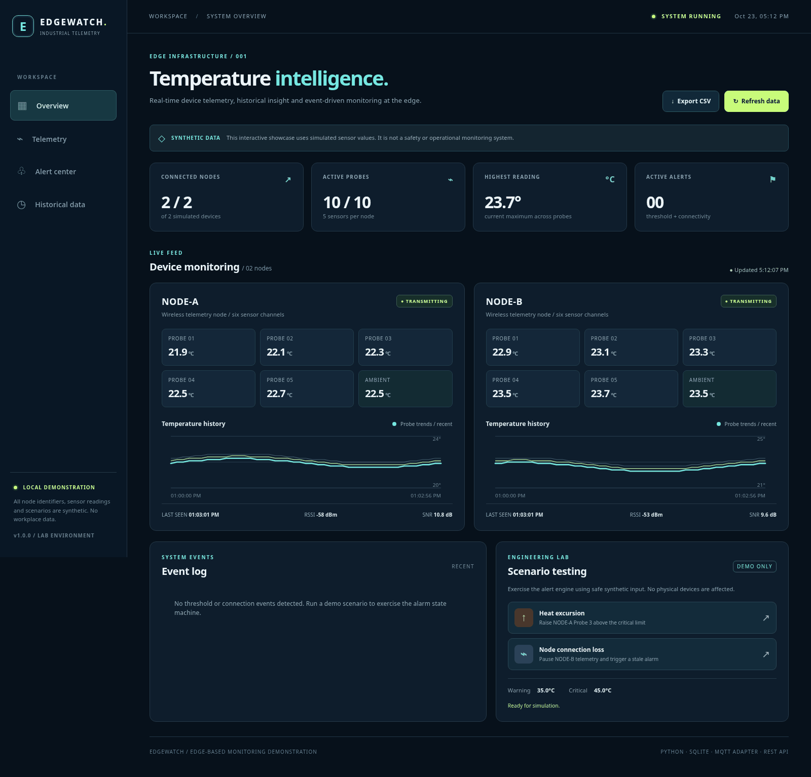
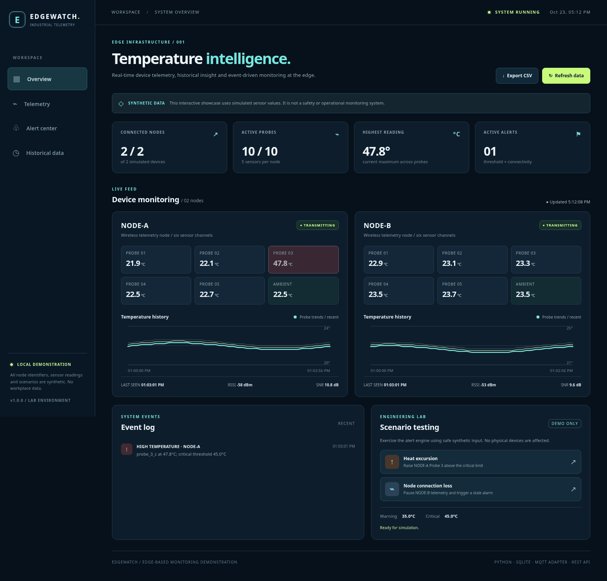
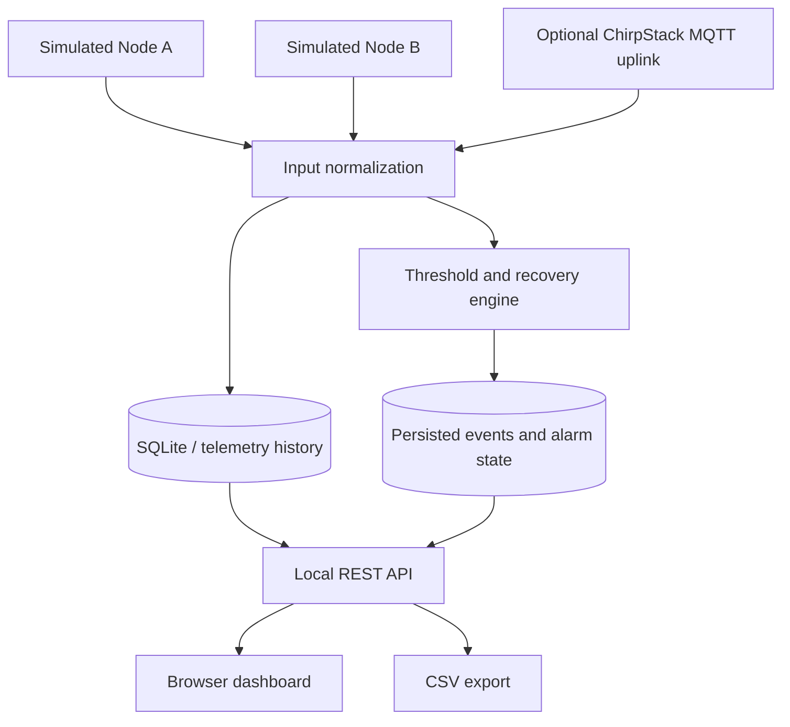

# EdgeWatch — Industrial IoT Temperature Monitoring

> **An interactive, edge-first telemetry dashboard with synthetic sensors, persistent readings, configurable alerts, CSV export, and optional ChirpStack MQTT ingestion.**

**Python 3.11+** · **SQLite** · **REST API** · **LoRaWAN/MQTT adapter** · **Docker Compose** · **Automated tests**



> [!IMPORTANT]
> **Public demonstration only.** All screenshots, identifiers, temperatures, and example messages in this repository are synthetic. This is an independently authored portfolio adaptation of engineering concepts—not the source or configuration of any employer's deployment. It has no safety certification, high-availability features, or guaranteed alarm-delivery capability. Never use it as the sole protective monitoring system.

## Why I built it

Industrial monitoring is a systems-integration problem, not just a sensor-reading problem. A reliable pipeline needs to decode telemetry, tolerate missed transmissions, timestamp readings, store useful history, and surface actionable events. This project demonstrates those building blocks in a reproducible, hardware-free application.

It was motivated by hands-on validation of a private two-node wireless temperature monitoring proof of concept. **No confidential infrastructure, private device IDs, keys, actual measurements, employer documentation, or source code were copied into this repository.**

### Features

| Capability | Implementation |
|---|---|
| 10 simulated temperature probes + 2 ambient channels | Two independent six-channel synthetic nodes |
| Live monitoring | Responsive dashboard that updates every 5 seconds |
| History | SQLite with write-ahead logging and downloadable CSV |
| Alarm state machine | Warning, critical, recovery, and offline transitions with hysteresis |
| Scenario testing | Synthetic heat excursions and device-outage buttons |
| Optional real telemetry adapter | ChirpStack v4 MQTT JSON uplink consumer (requires decoded fields) |
| Developer experience | Standard-library demo, Docker Compose, unit/API tests, GitHub Actions |

## Interactive browser demo (no installation)

Explore the standalone [`demo/`](demo/) application with simulated temperature sensors, history charts, heat/offline scenarios, configurable thresholds and CSV export. It runs entirely in a visitor's browser; it does **not** connect to actual telemetry, employer infrastructure, or the optional Python backend.

To run locally:

```bash
cd demo
python -m http.server 8000
```

Open http://127.0.0.1:8000. To deploy with GitHub Pages after review, follow the [demo deployment guide](demo/DEPLOYMENT.md). The Pages deployment workflow is **manual** and has not published this private repository.

## Try it in 60 seconds

**Option A — Python only (no external dependencies):**

```bash
git clone https://github.com/mhhassan1/industrial-iot-temperature-monitoring.git
cd industrial-iot-temperature-monitoring
python -m edgewatch --mode demo
```

Open **http://127.0.0.1:8765** in a browser.

**Option B — Docker Compose:**

```bash
docker compose up --build -d
```

Open **http://127.0.0.1:8765**. Stop using `docker compose down`.

In the dashboard, choose **Heat excursion** to see a synthetic high-temperature alarm, or **Node connection loss** to see an offline alert. Neither action interacts with real sensors.

**Windows note:** Use `py -3 -m edgewatch --mode demo` if your Python launcher is named `py`.

## What it looks like

| System overview | Interactive alarm demonstration |
|---|---|
| Two cards visualize five probes plus ambient per node | Heat event raises NODE-A Probe 3 above the simulated critical limit |
| Recent curves and signal quality from synthetic samples | Offline event temporarily suppresses NODE-B and exercises recovery |



CSV export is available from the top-right of the web dashboard. The export contains all locally saved synthetic readings and UTC timestamps.

## Architecture



The demo uses a built-in synthetic producer. In MQTT mode, decoded `object` fields from **ChirpStack v4** events can enter the same database and alarm state machine. The adapter does *not* implement a manufacturer's proprietary payload decoder, LoRaWAN network server, gateway bridge, or radio configuration.

See [technical architecture](docs/architecture.md), [case study](docs/engineering-case-study.md), and [installation/operation guide](docs/deployment.md).

## Optional ChirpStack integration

Install the optional dependency:

```bash
python -m pip install -e '.[mqtt]'
```

Configure an **authorized** MQTT endpoint with environment variables (from `.env.example`; environment variables are not automatically loaded from `.env`):

```bash
export MQTT_HOST=127.0.0.1
export MQTT_PORT=1883
export MQTT_TOPIC='application/+/device/+/event/up'
export EDGEWATCH_DB=./data/mqtt-readings.sqlite3
python -m edgewatch --mode mqtt
```

On Windows PowerShell, use `$env:MQTT_HOST='127.0.0.1'` style assignments. If broker credentials are needed, use `MQTT_USERNAME` and `MQTT_PASSWORD`, keeping them out of source control. Set `MQTT_TLS=true` and `MQTT_CA_CERT` when using a TLS-capable broker.

The adapter expects a successfully decoded ChirpStack JSON uplink with `fPort: 16` and six numeric keys: `probe_1_c` through `probe_5_c`, plus `ambient_c`. [Synthetic example JSON](examples/chirpstack_synthetic_uplink.json). Missing or malformed readings are skipped or rejected; port 42 is intentionally not interpreted as temperatures.

**Security:** The demo HTTP server has no authentication. Its default bind address is `127.0.0.1` and Compose publishes only on loopback. Do not expose it publicly or connect it to a workplace network without approved access controls.

## Run tests

```bash
python -m unittest discover -s tests -v
python scripts/prepublish_check.py
```

GitHub Actions runs the test suite on supported Python versions and performs a basic public-release pattern check. That check is not a substitute for a manual confidentiality or secret review.

## Repository guide

```text
industrial-iot-temperature-monitoring/
├── edgewatch/
│   ├── __main__.py         # Entrypoint: demo or MQTT mode
│   ├── simulator.py        # Deterministic synthetic node data + scenarios
│   ├── ingest.py           # ChirpStack event normalization
│   ├── mqtt_bridge.py      # Optional MQTT subscription
│   ├── storage.py          # SQLite, threshold state, stale detection, CSV
│   ├── server.py           # Local HTTP API
│   └── web/                # Browser dashboard, CSS, JavaScript
├── docs/                   # Architecture, case study, deployment, testing
├── examples/               # Fabricated events and sample CSV
├── tests/                  # Unit and HTTP API tests
├── assets/                 # Dashboard screenshot with synthetic data
├── compose.yaml            # Local-only demo container
├── Dockerfile
└── .github/workflows/ci.yml
```

## Engineering trade-offs and what comes next

- **Polling vs. streaming:** The UI polls every 5 seconds for simplicity; MQTT remains event-driven on the ingest side.
- **Durable alarm transitions:** SQLite persists severity and connectivity state, reducing duplicate alarms across restarts.
- **Offline semantics:** A stale timeout flags an absence of received data, which can be caused by device, RF, network, gateway, or server issues. It is not a reliable diagnosis of the root cause.
- **Sensor cadence:** Demo nodes publish every 4 seconds. This says nothing about a particular physical transmitter's capability.
- **Safety:** No email/paging service, SLA, redundancy, authentication, or safety-rated detection is implemented in this public release.

**Potential future work:** Proper authentication/reverse proxy, broker integration tests, observability metrics, alert acknowledgment workflows, retention policies, and container vulnerability scanning.

## Responsible disclosure and attribution

This is **original demonstration code** created with AI development assistance and reviewed/tested for this portfolio. It is not claimed to be a copy of production software or an employer-owned project. Do not replace synthetic examples with actual workplace data or upload equipment manuals without permission.

See [SECURITY.md](SECURITY.md) and the [publication checklist](docs/publication-checklist.md) before making a public repository.

## License

MIT — see [LICENSE](LICENSE). Third-party components (if installed separately) retain their own licenses.
