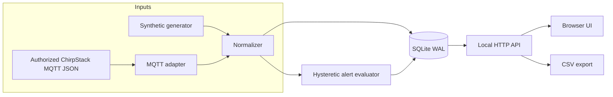

# Technical architecture

## Boundaries and trust

### Hardware abstraction

The synthetic simulator generates named `NODE-A` and `NODE-B` payloads to reproduce six numeric fields per device. The MQTT adapter expects ChirpStack's decoded *application object* in an uplink event. This cleanly separates vendor-specific binary decoding, radio settings, network security, and the showcase application.

### Event model

Each reading enters a SQLite transaction. The service evaluates five probe channels against warning and critical thresholds. It writes alert events only when severity changes, then persists the current severity to avoid producing identical alerts repeatedly. After a reading falls below the recovery margin, a recovered event is written.

Missing-data detection looks at the elapsed interval since the last received telemetry. It writes one offline event per outage and one recovered event upon resumption. An outage is not proof the transmitter is powered off; RF, gateway, network, or server problems can produce the same symptom.

### API reference

| Request | Returns |
|---|---|
| `GET /` | Dashboard |
| `GET /api/snapshot` | Device latest readings and alarms |
| `GET /api/history?device=NODE-A&limit=50` | Historical readings |
| `GET /api/alerts` | Most recent alarm transitions |
| `GET /api/export.csv` | All recorded readings in a CSV download |
| `GET /healthz` | Simple process availability response |
| `POST /api/demo/heat?device=NODE-A` | Triggers *synthetic* heat excursion |
| `POST /api/demo/offline?device=NODE-B` | Triggers *synthetic* missing-data test |

Demo POST commands are rejected in MQTT mode. The dashboard API is intentionally simple and unauthenticated, so localhost-only access is essential.

### Storage

SQLite is configured for WAL journaling. Each operation uses a short-lived connection. The schema contains `readings`, `alarm_state`, and `alert_events`. The CSV endpoint exports UTC timestamps, individual temperatures, source identity, and RSSI/SNR when provided.

### MQTT input requirements

For ChirpStack JSON `up` events, `deviceInfo.deviceName` identifies the device, `fPort=16` selects the expected payload, `object` must have six numeric temperature properties, and `rxInfo` optionally supplies radio quality. A real device profile must independently define and validate any binary codec; this repository does not reverse-engineer one.

ChirpStack MQTT format: https://www.chirpstack.io/docs/chirpstack/integrations/mqtt.html

### Deliberately excluded production capabilities

This project deliberately omits authentication/authorization, HTTPS termination, network isolation, durable cloud notifications, remote fleet management, redundant acquisition, automated backups, firmware management, and safety-rated alarm handling. These omissions keep the demonstration accessible; they prohibit direct production use.
